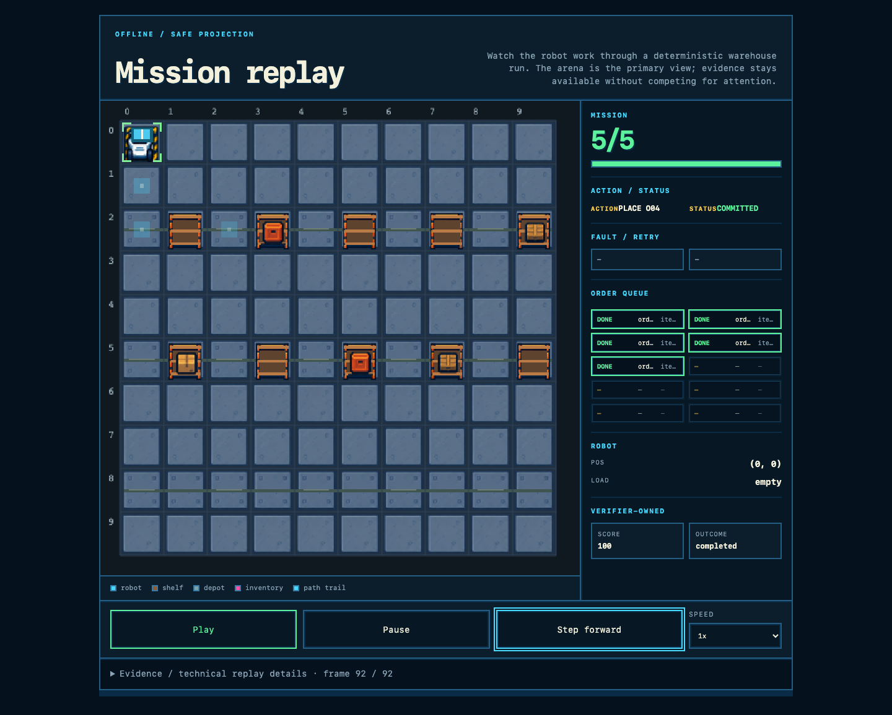

# Robot Factory & Arena

## A deterministic tactical replay for agent strategies

Robot Factory & Arena is an implemented v0 system for running bounded agent strategies against the same seeded warehouse task, then turning each run into sealed evidence, an offline replay, and a verifier-owned result.

**The boundary is simple:** the provider proposes, the deterministic core authorizes and executes, and the verifier owns the score and outcome. The core and its evidence can run without an LLM or network service.

[Open the live tournament results](docs/live-tournament-results.md) · [Read the architecture](docs/architecture/system-overview.md) · [Inspect the visualizer contract](docs/sdd/robot-run-visualizer.md)

## See the implemented outcome



*Final GLM R1 seed-18 replay: all 5 orders completed, verifier-owned score 100, and completed outcome. The visualizer is an offline, downstream projection of verified inputs—not a verifier, scorer, replay engine, or evidence authority.*

The released visualizer is self-contained: open it locally, step through the tactical run, and inspect the evidence details without a server or network call.

## Evidence snapshot

The repository publishes a small, bounded set of observed provider outcomes. It is **not a benchmark, scientific comparison, leaderboard, or general model ranking**.

| Observed run | Result | Safe reading |
|---|---|---|
| **GLM `glm-5.3-flash`** | **9/9 completed**, with a verifier-owned score of **100** | Every recorded condition/seed row completed under the published tournament setup. |
| **OpenAI `gpt-5.6-luna`** | Two 9-run tournaments; every run **safe-aborted** under the fixed **100-step** profile, with scores from **40–80** and **no provider request errors** | This is the observed outcome of these bounded runs, not a model-quality ranking. |

There are three seeds, one bounded task, and nine rows per tournament. See the [exact condition/seed rows and artifact sources](docs/live-tournament-results.md) before drawing any conclusion beyond the recorded evidence.

## Architecture at a glance


The diagram shows the authority flow from experiment context and provider proposals through deterministic execution, sealed evidence, independent verification, replay, and downstream observability. See the [human semantic architecture reference](docs/architecture/system-overview.md) for layer boundaries and connector semantics.

## Why it matters

Agent evaluations become difficult to trust when tasks change between runs, context leaks across conditions, agents report their own success, or observability is mistaken for authority. This project keeps those boundaries explicit:

| Layer | Implemented behavior | Authority boundary |
|---|---|---|
| **Experiment / search** | R1 human-directed, R2 autonomous, and R3 shared-discovery conditions search under a frozen `StrategyContext`. | Context is advisory; it is not world state or score authority. |
| **LLM policy / provider adapter** | An optional provider proposes the next action, normalized to a `ToolCall`. | Provider output cannot execute directly or bypass the core. |
| **Deterministic core** | `Runner`, `Budget`, `Grants`, `ToolBay`, `apply()`, and serializable `WorldState` enforce the execution contract. | The core owns authorization, committed operations, and state transitions. |
| **Sealed evidence** | Canonical artifacts, append-only trace data, receipt bindings, reports, and replay inputs are recorded for each run. | Evidence is the input to review; self-reported success is not authority. |
| **Independent verifier** | An artifact-only verifier checks invariants and derives the official integer score and outcome. | The verifier owns the reported result, independently of policy and observation views. |
| **Visualizer / observability** | Offline visualizer and self-hosted Langfuse projection consume sealed evidence downstream. | They are optional and fail-open: they cannot authorize, score, verify, or reclassify a run. |

## Quick path

Requirements: Python 3.14+ (the current test gate is exercised with Python 3.14.5). The core has no runtime dependencies.

```text
# Run the full stdlib unittest gate
python3 -m unittest discover -s tests -v

# Execute one evidenced run; the command prints its run directory
python3 -m robot_factory_arena.cli run --seed 17 --policy greedy-v0

# Execute a fresh physical run under the same logical identity and compare it
python3 -m robot_factory_arena.cli rerun --seed 17 --policy greedy-v0

# Replay the exact run directory printed by run or rerun
python3 -m robot_factory_arena.cli replay artifacts/runs/<logical_run_id>/<execution_id>
```

`run` releases a verified receipt and a static `report.html`. `rerun` invokes the policy again and compares deterministic artifacts; it is not replay. `replay` reads only `replay-input.json` and `receipt.json`, never imports or calls a policy/provider, and reports whether the final-state digest and outcome match the receipt while displaying the verifier-owned score.

Exit codes are intentional: `0` means success or agreement, `1` means evidence disagreement or invalid verification, and `2` means a usage or artifact error.

### Optional visualizer

A successful verified run may also release a self-contained `visualizer.html` beside `report.html`.

```text
# macOS
open <run_directory>/visualizer.html

# Linux
xdg-open <run_directory>/visualizer.html
```

It works from a local `file:` URL and needs no server or network. It provides Play, Pause, Step forward, and fixed `0.5x`/`1x`/`2x`/`4x` speeds. One frame is one consumed policy step; a response-loss retry remains an ordered subevent of that frame. If generation fails or the optional file is deleted, the core receipt, report, replay, score, and outcome remain valid.

For a deterministic response-loss demonstration, the fault target is declared rather than discovered by a policy:

```text
python3 -m robot_factory_arena.cli run --seed 18 --policy greedy-v0 \
    --fault-step 8 --fault-intent place-order-00
```

The committed seed-18 fixture exercises one response loss after commit, an internal retry, and a verifier-owned score of 100 within the locked 100-step budget. Seed 17 (`greedy-v0`) remains the public fixture, while seed 29 (`bounded-v0`) remains plumbing-only evidence.

## What the system proves

- A bounded, seeded execution path whose artifacts can be replayed and compared.
- Separation between proposal, authorization, committed state transition, evidence, and verification.
- Independent score/outcome derivation from sealed artifacts rather than agent claims.
- Fault-aware handling of duplicate delivery and response loss, including safe-abort or unresolved classifications.
- Deterministic fake acceptance for R1/R2/R3 harness behavior, separate from live-provider runs.

Each run reports four separate signals, each on a 0–100 scale:

1. **Task quality** — deterministic verifier score.
2. **Efficiency** — actions and wall time.
3. **Robustness** — behavior under injected faults.
4. **Contract hygiene** — permission violations, idempotency breaches, and audit completeness.

They are intentionally never collapsed into one composite score.

## Claims boundary

The v0 implementation is intentionally narrow: one seeded warehouse task, programmatic reference policies, a bounded local core, and evidence that can be replayed without a provider. It makes no exactly-once or production-security claim, and it does not claim to reproduce REFUGIO scientifically.

More precisely:

- **No exactly-once effects:** idempotency keys and the operation/audit ledger support duplicate detection; replay and rerun support comparison and reconciliation. The persistence boundary is not a distributed transaction. If a response is lost after a commit, the caller can be uncertain whether the effect was applied; the deterministic fault tape classifies that ambiguity from recorded evidence rather than upgrading it to an exactly-once guarantee.
- **No authenticated provenance:** trace hashes and receipt/digest bindings provide tamper evidence for recorded core artifacts, not authentication or proof of external provenance. Harness checkpoints and discovery/decision logs provide sequence and continuity validation, not general cryptographic tamper evidence.
- **No benchmark claim:** the live-provider fixture set is small and bounded; it is not a frontier benchmark, leaderboard, scientific comparison, or general model-performance claim.
- **No production boundary:** this is not a hostile-Python sandbox, production deployment, or general security boundary for arbitrary policy code.
- **No model training:** providers are inference integrations only.
- **No composite score:** task quality, efficiency, robustness, and contract hygiene remain separate signals.

## Optional integrations

### Tournament harness

The optional `harness/` package runs R1/R2/R3 tournaments over the frozen core. It freezes one provider/model per tournament, snapshots `StrategyContext`, launches the core through registered subprocesses, binds evidence fail-closed, and writes one authoritative leaderboard row per `(condition, seed)`. The core remains stdlib-only; the harness is an outer orchestration layer.

```text
python3 -m pip install -e ".[harness]"
python3 -m harness --config tests/fixtures/harness/unit6-acceptance-config.json \
    --runner fake --non-interactive --root /tmp/harness-demo
```

The fake acceptance is deterministic and separate from provider-backed results. See the [harness operator contract](docs/sdd/phase6-langgraph-harness.md) for execution profiles, R1/R2/R3 semantics, artifact layout, recovery windows, and deliberately narrow guarantees. See the [live tournament results](docs/live-tournament-results.md) for observed provider outcomes.

### Observability

`observability/` provides a downstream-only, self-hosted [Langfuse](https://langfuse.com/docs) v3.114.0 projection and a stdlib-only exporter for sealed run evidence. The source artifacts remain authoritative; removing the stack cannot alter them. Start-up, environment-variable names, pins, export behavior, and the optional smoke are documented in [observability.md](docs/observability.md). The UI port is `3000`; credentials stay in the environment and are never part of the repository or evidence artifacts.

## Roadmap

| Phase | Status | Evidence or next step |
|---|---|---|
| **0. Charter** | **Complete** | Scope, constraints, and the evidence-first architecture are documented. |
| **1. MVP core** | **Complete** | Seeded task, world, ToolBay, policies, budgets, verifier, trace/replay, receipt, and report are implemented. |
| **2. Robustness** | **Complete** | Fault tapes, duplicate detection, safe-abort/unresolved classification, and replay-equivalent recovery paths are implemented. |
| **3. Arena conditions** | **Complete** | R1/R2/R3 orchestration, deterministic fake acceptance, and real tournament artifacts are complete; scientific comparison remains out of scope. |
| **4. Providers and observability** | **Complete** | The provider and downstream observability path is implemented and validated; neither path becomes authority. |
| **5. Analysis and evidence publication** | **Complete for current v0** | Current v0 result summaries, committed golden receipts, limitations, and non-benchmark claims are published. |
| **6. Wider expansion** | **Optional** | Additional tasks, providers, or experiments are future work only if they preserve the evidence and authority boundaries. |

## Technical references

- [Semantic architecture reference](docs/architecture/system-overview.md) and [architecture SVG](docs/architecture/system-overview.svg)
- [Core CLI](robot_factory_arena/cli.py), [core implementation](robot_factory_arena/), and [test suite](tests/)
- [Deterministic core specification](docs/sdd/spec.md), [design](docs/sdd/design.md), [tasks](docs/sdd/tasks.md), and [verification report](docs/sdd/verify-report.md)
- [Tournament harness contract](docs/sdd/phase6-langgraph-harness.md)
- [Live tournament results](docs/live-tournament-results.md)
- [Visualizer contract](docs/sdd/robot-run-visualizer.md)
- [Langfuse observability contract](docs/observability.md)
- [Focused CLI and replay tests](tests/test_cli.py), [rerun/replay tests](tests/test_rerun_replay.py), [harness acceptance](tests/test_harness_acceptance.py), and [visualizer release tests](tests/test_visualizer_release.py)
- REFUGIO Madrid 2026 — [“Speedrunning as a model of progress”](https://refugiomadrid.com/paper.html), the inspiration for the shared-discovery question
- Terminal-Bench 2.x and [“What Makes a Good Terminal-Agent Benchmark Task”](https://arxiv.org/abs/2604.28093), for adversarial deterministic verification context
- ARC-AGI-3, for treating action efficiency as a first-class metric; and GAIA ([arXiv:2311.12983](https://arxiv.org/abs/2311.12983)), for the documented human–agent performance gap
- [Roadmap](#roadmap)
