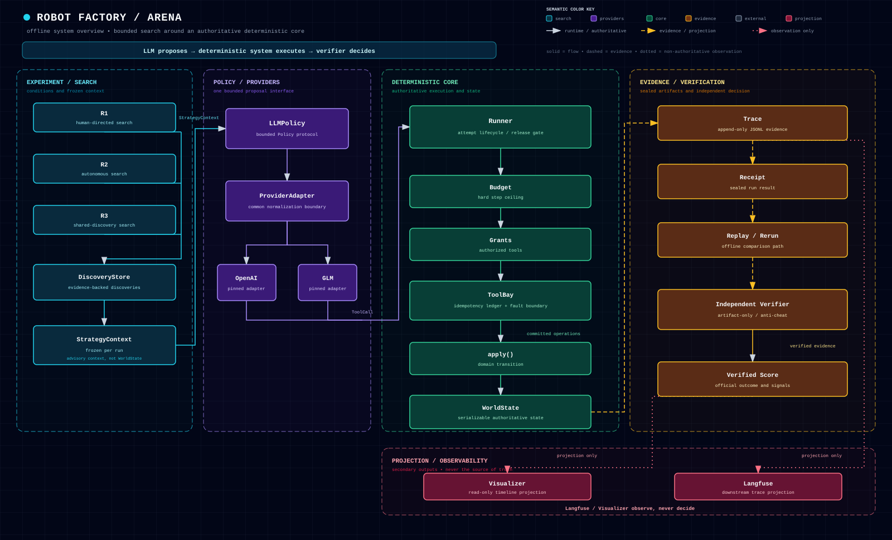

# System overview

This page is the human semantic reference for the Robot Factory and Arena portfolio architecture. It explains the boundary between bounded search, provider-backed proposals, deterministic execution, and independent verification; it is not a new runtime source of truth.

> **Core message:** `LLM proposes → deterministic system executes → verifier decides`
>
> **Observation boundary:** `Langfuse / Visualizer observe, never decide`

## Quick path

1. R1, R2, or R3 searches across bounded runs and publishes evidence-backed discoveries.
2. A frozen `StrategyContext` enters `LLMPolicy`, which normalizes an OpenAI or GLM response into a `ToolCall`.
3. The deterministic core enforces budget and grants, applies committed operations to `WorldState`, and records evidence.
4. Replay, rerun, and the independent verifier derive the official `Verified Score` from sealed artifacts.

## Layers and authority

| Layer | Responsibilities | Authority boundary |
| --- | --- | --- |
| **Experiment / Search** | R1 human-directed, R2 autonomous, and R3 shared-discovery search; `DiscoveryStore`; frozen per-run `StrategyContext`. | Supplies advisory context and schedules attempts. It does not mutate `WorldState` or decide the score. |
| **Policy / Providers** | `LLMPolicy`, `ProviderAdapter`, and pinned OpenAI / GLM adapters. | Proposes one normalized `ToolCall`; provider output cannot execute directly or bypass the core. |
| **Deterministic Core** | `Runner`, `Budget`, `Grants`, `ToolBay`, `apply()`, and serializable `WorldState`. | Owns runtime behavior, authorization, committed operations, and state transitions. |
| **Evidence / Verification** | `Trace`, `Receipt`, `Replay / Rerun`, `Independent Verifier`, and `Verified Score`. | Sealed evidence and verifier-owned results are authoritative; self-reported success is not. |
| **Projection / Observability** | Langfuse and the offline Visualizer. | Downstream, non-authoritative views. They may be unavailable without changing core evidence or decisions. |

## Connector semantics

- **Solid arrows** represent runtime or authoritative flow.
- **Dashed arrows** represent evidence or projection flow.
- **Dotted arrows** represent non-authoritative observation.
- Labels are intentionally limited to the contract edges: `StrategyContext`, `ToolCall`, `committed operations`, `verified evidence`, and `projection only`.

## Design constraints

- The core stays deterministic, replayable, budgeted, and independent of providers, LangGraph, Langfuse, and the R1/R2/R3 orchestration layer.
- `StrategyContext` is frozen before a run and remains advisory context, not world state.
- Replay starts from recorded evidence and never calls a live provider.
- Langfuse and Visualizer can render or export observations, but neither can authorize, score, verify, or reclassify a run.
- The diagram is intentionally offline: the HTML and SVG use embedded shapes, a subtle grid, and a local/system monospace fallback with no network assets.

## Reading the artifact set

- [`system-overview.svg`](system-overview.svg) is the GitHub-readable embed.
- [`system-overview.html`](system-overview.html) is the self-contained browser view with the same inline SVG and short architecture notes.
- The implementation and evidence contracts remain in the Python package, tests, and phase-specific documentation; update this page when the architecture boundary changes.
